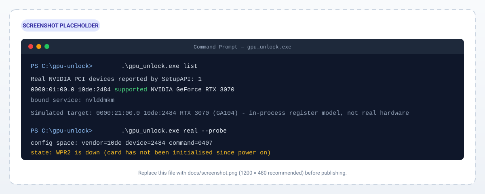

# gpu-unlock for Windows

> 在 Windows 上解锁 NVIDIA Ampere GeForce 显卡（GA102 / GA103 / GA104 / GA106）完整的 FP/BF16 指令发射速率——无需修改 NVIDIA 驱动。

[](licenses/GPL-2.0.txt)


[English](README.md) · **简体中文**

## 预览



---

`gpu-unlock for Windows` 是 [Zagitta/gpu-unlock](https://github.com/Zagitta/gpu-unlock) Linux 内核模块的 Windows 移植版。它从用户态应用同一套 **CMP unlocker V67/PLM** 技术：写入 GPU 速度选择器（SS0 `0x88888888`，选中完整 BF16 速率；以及 4 位 SS1 `0x8` IMLA4），执行一次 PCIe FLR，然后让未经修改的 NVIDIA 驱动正常绑定显卡。

在受支持的显卡上，结果是 **FP/BF16 FMA-into-FP32 发射速率最高约 2 倍**，且不修改驱动、不需要 UEFI 应用。

> **在找原来的 Linux 内核模块？** 它的解锁引擎仍在，而且正是本移植版编译的那份——`kernel/gpu_unlock/` 为共享代码。Linux 侧脚手架（kbuild、DKMS、`debian/`、`packaging/`）已移除，因此该模块无法再在 Linux 上构建。Linux 文档归档于 [`docs/README.linux.md`](docs/README.linux.md)，被移除的构建文件副本在 [`docs/linux-legacy/`](docs/linux-legacy/)。本文件其余内容只讲 Windows 移植版。

> **这是硬件修改工具，不是软件破解。** 它会写入未公开的 GPU 寄存器。在你依赖的机器上运行之前，请先阅读[安全、风险与保修](#安全风险与保修)。

---

## 目录

- [预览](#预览)
- [如何运行](#如何运行)
- [工作原理](#工作原理)
- [特性](#特性)
- [环境要求](#环境要求)
- [构建](#构建)
- [部署目录](#部署目录)
- [使用方法](#使用方法)
- [命令行参考](#命令行参考)
- [支持的显卡](#支持的显卡)
- [固件](#固件)
- [架构](#架构)
- [安全、风险与保修](#安全风险与保修)
- [故障排查 / FAQ](#故障排查--faq)
- [已知限制](#已知限制)
- [贡献](#贡献)
- [许可与归属](#许可与归属)

---

## 如何运行

`gpu_unlock.exe` 是**便携式控制台程序**：没有安装程序、不需要预先注册服务、也没有配置文件。把两个可执行文件和一份固件目录放进同一个文件夹，直接运行即可。

### 一个文件夹里需要什么

```
gpu_unlock.exe          <- 由 windows/ 构建
gpuunlock.sys           <- 由 windows/driver/ 构建
gpu-unlock\610.43.03\   <- firmware/ 产出的五个 Blob
```

完整目录树与各部分来源见[部署目录](#部署目录)。

### 四个步骤

**1. 构建两个二进制文件** —— `windows\build.ps1` 与 `windows\build_driver.ps1`，详见[构建](#构建)。

**2. 签名驱动一次，然后重启** —— 需管理员，否则内核不会加载未签名的测试驱动：

```powershell
powershell -ExecutionPolicy Bypass -File windows\sign_driver.ps1 -EnableTestSigning
```

**3. 放好固件** —— `gpu-unlock\610.43.03\` 必须在 `gpu_unlock.exe` 旁边。缺了它真实解锁会被拒绝。

**4. 运行** —— 双击走一键路径，或在控制台里逐步执行：

```powershell
gpu_unlock.exe list           # 系统里有哪些 NVIDIA 设备，我的卡受支持吗？
gpu_unlock.exe verify         # 用内置模拟卡完整跑一遍
gpu_unlock.exe real --probe   # 只读查看真实显卡（需管理员 + 驱动）
gpu_unlock.exe real           # 真正解锁：屏幕会黑，需要输入 YES
```

推荐用控制台方式：只有在命令行里才能传 `--bdf`、`--pre-flr`、`--cold`、`--assets`。

### 双击会发生什么

不带参数启动 `gpu_unlock.exe` 等同于 `gpu_unlock.exe real`，只多一件事：从资源管理器双击时程序会保留窗口（`Press any key to exit...`），便于看清结果。具体会：

1. 弹出 UAC 并以管理员身份重新启动自己（拒绝则退出码 1）；
2. 创建并启动内核服务 `GpuUnlock`，指向 exe 旁的 `gpuunlock.sys`；
3. 选中**第一个**受支持的 NVIDIA 设备并打印其 BDF；
4. 提示将要禁用显示适配器，要求输入 `YES`；
5. 禁用适配器（屏幕变黑）、经驱动执行解锁、随后重新启用；
6. 打印 `unlock read-back: PASS` 或 `FAIL`。

它无法选择显卡、跳过确认或清理已初始化的 GSP——这些要用命令行。

### 各命令的前置条件

| 命令 | 管理员 | `gpuunlock.sys` | 真实 `610.43.03` 固件 |
|---|---|---|---|
| `list` | 否 | 否 | 否 |
| `verify` | 否 | 否 | 否 —— 由 `assets_builtin.c` 合成 Blob |
| `real --probe` | **是** | 是 | 否 —— 只读寄存器 |
| `real`（及双击） | **是** | 是 | **是** |
| `version`、`help` | 否 | 否 | 否 |

`list` 与 `verify` 在任何机器上都安全：不加载驱动、不碰显卡、不需要提权。

### 卸载 / 清理

程序不写入 Program Files，也不创建开机自启项。彻底移除：删除文件夹，然后（管理员）删除首次真实运行时注册的内核服务：

```powershell
sc.exe stop GpuUnlock
sc.exe delete GpuUnlock
```

如不再需要，可用 `bcdedit /set testsigning off` 关闭测试签名并重启。

---

## 工作原理

Windows 版保留原内核解锁引擎**不做改动**，只是换了一个宿主：

1. **枚举** —— `backend_win32.c` 通过 SetupAPI 列出 NVIDIA PCI 功能，选中第一个受支持的设备，或使用 `--bdf` 指定的设备。
2. **提权并加载驱动** —— `gpu_unlock.exe` 请求 UAC，把 `gpuunlock.sys` 注册为按需启动的内核服务（`GpuUnlock`，设备链接 `\\.\GpuUnlock`）。
3. **禁用适配器** —— `DICS_DISABLE` 卸载 `nvlddmkm` 并释放显卡。显示卡此刻会黑屏。
4. **运行原引擎** —— Linux 模块使用的同一套源码（`main.c`、`unlock_610.c`、`prep_610.c`、`layout_610.c`、`vbios_610.c`、`gfw_eval.c`）针对 Linux API 兼容层（`windows/include/linux/`）编译进可执行文件。Linux 模块注册宏被置为空宏，因此 `gpu_unlock_init()` / `gpu_unlock_exit()` 作为普通函数运行。
5. **经驱动完成机械 I/O** —— `gpuunlock.sys` 只暴露用户态做不到的操作：PCI 配置空间读写、BAR 映射、物理连续 DMA、PCIe FLR 与 D0 转换。**解锁策略全部留在用户态。**
6. **解锁序列** —— 加载 V67/PLM 固件，运行 FWSEC-FRTS（抬升 WPR2），启动 Booter，写入 SS0/SS1，发起 FLR。
7. **验证** —— 工具回读选择器。`SS0 == 0x88888888 && SS1 == 0x8 && GSP 已停 && 发生过 FLR` 才报告 `PASS`。
8. **重新启用** —— `DICS_ENABLE` 让 PnP 重新绑定 `nvlddmkm`。本次电源周期内，显卡以解锁后的速率运行。

内置一个 **模拟 GA104 后端**（`backend_sim.c`，RTX 3070 `10de:2484`，BDF `0000:21:00.0`）。它是进程内的寄存器模型——不触碰真实 PCI 配置空间或 BAR——用于在任何机器（甚至无独显）上测试完整事务。

---

## 特性

- **不修改驱动。** 不受 NVIDIA 驱动更新影响；磁盘上的驱动文件保持原样。
- **Pre-driver 时机。** 解锁在适配器被禁用之后、`nvlddmkm` 重新绑定之前执行。
- **与 Linux 模块同一引擎。** 逐字节复用已验证的解锁逻辑。
- **极小的内核面。** 驱动只做机械的 PCI/DMA/FLR 操作，所有策略在用户态。
- **内置模拟器。** `verify` 用合成固件在任何 GPU（或没有 GPU）上跑通完整路径。
- **只读探测。** `real --probe` 打印 PMC/GFW/PLM/SS0/SS1/WPR2，不写入任何内容。
- **显式确认。** 真实解锁会黑屏，并要求你输入 `YES`。
- **失效安全报告。** 成功与否由寄存器回读决定，而不是只看退出码。
- **测试签名、开源。** GPL-2.0-only，源码可审计，除 NVIDIA 固件外无二进制 Blob。

---

## 环境要求

### 运行环境

| 要求 | 说明 |
|---|---|
| 操作系统 | Windows 10 / 11，x64 |
| 权限 | `real` 与双击路径需管理员（UAC 提示）；`list`、`verify`、`version`、`help` 不需要提权 |
| 驱动 | `gpuunlock.sys`，**自签名**，并开启测试签名；注册为内核服务 `GpuUnlock` |
| Secure Boot | **必须关闭。** 在 Secure Boot 策略生效时 `bcdedit /set testsigning on` 会被拒绝，驱动将永远无法加载 |
| 固件 | 真实 `610.43.03` 的五个 Blob，放在 exe 旁的 `gpu-unlock\610.43.03\`；仅真实解锁需要 |
| 显卡 | 受支持的 Ampere GeForce（见[支持的显卡](#支持的显卡)） |
| NVIDIA 驱动 | 真实使用需已安装（`nvlddmkm`）；`verify` 不需要 |
| 运行时 DLL | 无需安装：可执行文件静态链接 C 运行时，只导入系统自带的 `KERNEL32`、`ADVAPI32`、`SETUPAPI`、`SHELL32`，不依赖 VC++ 运行库 |

### 构建环境

| 工具 | 用途 |
|---|---|
| Visual Studio 2019/2022（Build Tools 或完整 IDE），需 **C/C++ x64** 组件（`Microsoft.VisualStudio.Component.VC.Tools.x86.x64`） | 编译 exe 与驱动的 `cl.exe` / `link.exe` |
| Windows 10/11 SDK（UCRT 头文件如 `ucrt\stdio.h`，以及 `signtool.exe`） | 用户态编译与驱动签名 |
| Windows Driver Kit（WDK，`Microsoft.WindowsWDK`） | `km\ntddk.h`、`ntoskrnl.lib`、`hal.lib`、`wdmsec.lib`、`BufferOverflowK.lib` |
| PowerShell 5.1+ | 构建与签名脚本；脚本自行定位 MSVC/SDK/WDK，无需 Developer Command Prompt |
| Python 3.11+ | 固件管线（`hashlib.file_digest`）与测试套件；若已有 Blob 可省略 |

> `windows/build.ps1` 通过 `vswhere.exe` 定位 MSVC，需要 `VC.Tools.x86.x64` 组件，以及含 `ucrt\stdio.h` 的 Windows 10 SDK。`windows/build_driver.ps1` 则需要 WDK 的 `km\ntddk.h` 与 `Windows Kits\10\Lib\<ver>\km\x64` 下的内核库。

---

## 构建

在仓库根目录用 PowerShell 执行。

### 1. 用户态可执行文件

```powershell
powershell -ExecutionPolicy Bypass -File windows\build.ps1
```

生成 `build\gpu_unlock.exe`（目标文件在 `build\obj\`）。

### 2. 内核驱动

```powershell
powershell -ExecutionPolicy Bypass -File windows\build_driver.ps1
```

生成 `build\gpuunlock.sys`（目标文件在 `build\drvobj\`）。

### 3. 签名并开启测试签名（需管理员）

```powershell
powershell -ExecutionPolicy Bypass -File windows\sign_driver.ps1 -EnableTestSigning
```

该脚本会创建/复用自签名代码签名证书、为当前用户信任该证书、签名 `gpuunlock.sys`、验证签名，并开启 `testsigning`。

> **两个构建脚本都带了 `/pathmap`**，会把 `__FILE__` 和目标文件里的绝对路径重写为
> `C:\gpu-unlock-src\...`，而不是编译者真实的用户目录。因此从本仓库编译出的二进制
> **不会泄露构建账户**。注意 `/pathmap` 必须搭配 `/experimental:deterministic`，
> 否则 MSVC 会静默忽略它——这正是发布出去的 EXE 里出现 `C:\Users\<账户>\...` 的常见原因。

> **开启测试签名后必须重启。** 测试签名生效前驱动无法加载。

若只想签名而不开启测试签名，去掉 `-EnableTestSigning` 即可。

### 4. 固件 Blob

真实解锁需要五个 `610.43.03` Blob。用共享的 Python 管线生成（Linux/WSL 上的标准入口是 `make firmware`；Windows 下直接运行脚本）：

```powershell
python firmware\fetch_artifacts.py <缓存目录>
python firmware\generate_v67.py <nvidia-utils 包> <资产目录>
python firmware\extract_boot_assets.py <nvidia 源码目录> <资产目录>
```

脚本在写入前会用 `firmware/artifacts-610.43.03.json` 中固定的 SHA-256 校验每个输入。把输出复制到部署目录（见下）。

### 5. 测试（可选）

```powershell
python -m unittest discover -s tests -v
```

`test_firmware_manifest.py` 校验生成的 V67 payload 与固定的 SHA-256 是否一致，总会运行。`test_release.py` 需要编译共享 C 引擎，因此要求 `PATH` 中有 `cc`（gcc 或 clang——Windows 上即 MinGW/MSYS2）；没有编译器时它会**自动跳过**而不是报错。这些才是能发现 `kernel/gpu_unlock/`（可执行文件的构建来源）回归的测试。

---

## 部署目录

没有安装程序。按便携目录部署；可执行文件会相对自身路径解析驱动与固件：

```
gpu_unlock.exe
gpuunlock.sys
gpu-unlock\
└── 610.43.03\
    ├── booter_load_ga102.bin
    ├── v67-ga102-610.43.03.bin
    ├── gsp_ga10x.bin
    ├── gsp_boot_ga102.bin
    └── gsp_boot_desc_ga102.bin
```

- `gpuunlock.sys` 必须与 `gpu_unlock.exe` **同级**（或使用 `--driver PATH`）。
- 固件目录解析为 `<exe 所在目录>\gpu-unlock\610.43.03`（或使用 `--assets DIR`）。
- 缺少固件目录时，`list`、`verify`、`real --probe` 仍可用；真实解锁会报 `real firmware is required; place the 610.43.03 blobs ...`。
- 两个构建脚本只写入 `build\`，拼装这个文件夹需要手动复制。不会向系统任何位置安装东西。

---

## 使用方法

> 先 `gpu_unlock.exe list`，再 `verify`，再 `real --probe`，最后才做真实解锁。

### 1. 枚举真实显卡

```powershell
gpu_unlock.exe list
```

打印每个 NVIDIA PCI 功能的 BDF、vendor:device、`supported` / `ignored` 状态、绑定服务，以及模拟目标。

### 2. 用模拟器自测

```powershell
gpu_unlock.exe verify
gpu_unlock.exe verify --resume
```

在模拟 GA104 上跑完整事务。`--resume` 还会模拟一次挂起/恢复周期。不需要硬件、不需要驱动。

### 3. 真实硬件只读探测

```powershell
gpu_unlock.exe real --probe
gpu_unlock.exe real --probe --bdf 0000:01:00.0
```

加载驱动并打印 `PMC_BOOT_0`、`GFW_CPUCTL`、`GFW_BOOT`、`GFW_PLM`、`SS0`、`SS1`、`WPR2` lo/hi、FB 大小与 VGA。**不写入任何内容。** 需要管理员权限与 `gpuunlock.sys`，但**不需要固件**。若 WPR2 已抬起，说明该卡本次开机后已被初始化，冷路径会拒绝它。

### 4. 真实解锁

```powershell
# 交互式：禁用适配器，并要求输入 YES
gpu_unlock.exe real

# 非交互，指定显卡
gpu_unlock.exe real --bdf 0000:01:00.0 --yes

# 显卡已被驱动初始化：先清除 GSP
gpu_unlock.exe real --pre-flr

# 开机前已禁用适配器、WPR2 处于 down
gpu_unlock.exe real --cold
```

成功时以如下输出结束：

```
unlock read-back: PASS
```

### 5. 一键（双击）路径

不带参数启动 `gpu_unlock.exe` 会请求提权、在缺失时安装/加载驱动、解锁第一个受支持的显卡，并在退出前暂停以便查看结果。

它等同于 `gpu_unlock.exe real` 加上"暂停"这一步，因此无法选择显卡、无法跳过 `YES` 确认、也无法清理已初始化的 GSP。需要这些能力时请用命令行。分步说明见[如何运行](#如何运行)。

### 6. 版本与帮助

```powershell
gpu_unlock.exe version
gpu_unlock.exe help
```

---

## 命令行参考

```
gpu_unlock.exe [命令] [选项]
```

### 命令

| 命令 | 说明 |
|---|---|
| *（无）* | 一键：提权 → 确保驱动 → 解锁第一个受支持显卡 → 暂停 |
| `list` | 通过 SetupAPI 枚举 NVIDIA PCI 设备 |
| `verify [--resume]` | 在模拟 GA104 上运行事务 |
| `real [--probe] [--bdf BDF] [--assets DIR] [--driver PATH] [--yes] [--quiet] [--cold] [--pre-flr]` | 解锁真实硬件 |
| `version` | 打印版本 |
| `help`、`--help`、`-h` | 显示用法 |

### 选项

| 选项 | 适用命令 | 含义 |
|---|---|---|
| `--bdf BDF` | `real` | 目标 PCI 功能，例如 `0000:01:00.0`。完整 PCI 名称，大小写不敏感，与 GPU 编号无关 |
| `--assets DIR` | `real`、`verify` | 从 `DIR` 加载真实 `610.43.03` Blob，而非默认的 `gpu-unlock\610.43.03` |
| `--driver PATH` | `real` | 安装/启动指定驱动，而非 exe 旁的 `gpuunlock.sys` |
| `--yes` | `real` | 跳过交互式 `YES` 确认。`--cold` 会自动隐含此项（此时没有适配器需要禁用，也就没有确认环节） |
| `--quiet` | `real`、`verify` | 抑制信息性日志 |
| `--cold` | `real` | 不禁用适配器：它在开机前已被禁用，WPR2 已 down，适用冷路径。同时隐含 `--yes` |
| `--pre-flr` | `real` | 解锁前先用 FLR 重置已初始化的 GSP |
| `--probe` | `real` | 只读寄存器转储；绝不写入。仍需提权，因为它要打开驱动 |
| `--resume` | `verify` | 额外模拟恢复后的解锁 |

### 退出码

| 退出码 | 含义 |
|---|---|
| `0` | 成功（`real` 以回读 `PASS` 为准） |
| `1` | 失败（驱动错误、未找到受支持显卡、回读 `FAIL`） |
| `2` | 命令行参数错误 |

---

## 支持的显卡

引擎接受以下 NVIDIA PCI 设备 ID（`kernel/gpu_unlock/main.c` 中的 `supported_ids[]`）。它排除音频功能与专业（GL）型号——后者本就以满速率运行 BF16；GA103 与 GA106 还按注记排除移动版。

| 芯片 | 接受的设备 ID |
|---|---|
| **GA102** | `2200` `2203` `2204` `2205` `2206` `2207` `2208` `220a` `220d` `2216` `222b` `222f` |
| **GA104** | `2480` `2482` `2483` `2484` `2486` `2487` `2488` `2489` `248a` `248c` `248d` `248e` `249c` `249d` `249f` `24a0` `24a4` `24ac` `24ad` `24af` `24bf` `24c0` `24c7` `24c8` `24c9` `24dc` `24dd` `24df` `24e0` |
| **GA103** | `2414`（未测试） |
| **GA106** | `2501` `2503` `2504` `2505` `2507` `2508` `2509` `252f` `2544` |
| **GA106M** | `2520` `2560` |

**接受 ≠ 已验证。** 社区实测结果：

| 芯片 | 显卡 | PCI ID | 结果 | BF16 GEMM 提升 |
|---|---|---|---|---|
| GA102 | RTX 3090 Ti | `10de:2203` | 已解锁 | +68–80% |
| GA102 | RTX 3090 | `10de:2204` | 已解锁 | +25–67% |
| GA102 | RTX 3080 Ti 20 GB（OEM） | `10de:2205` | 流程完成，**BF16 仍为半速** | — |
| GA102 | RTX 3080 10 GB | `10de:2206` | 已解锁 | +70–73% |
| GA102 | RTX 3080 20 GB | `10de:2206` | 已解锁 | +56–59% |
| GA104 | RTX 3070 | `10de:2484` | 已解锁 | +73–81% |
| GA104 | RTX 3070 LHR | `10de:2488` | 已解锁 | +77–84% |
| GA104 | RTX 3070 Ti | `10de:2482` | **本模块未测试**（UEFI 版成功） | — |
| GA103 | 任意 | `10de:2414` | **无报告** | — |
| GA106 | RTX 3060 12 GB | `10de:2504` | 已解锁 | ≈ +80% |
| GA106M | RTX 3060 Laptop 6 GB | `10de:2560` | 已解锁 | +56–60% |

**不支持：** RTX 40/50 系（Ada/Blackwell）、Turing（RTX 20 系），以及专业 RTX A / Quadro 型号。

**关于 3070：** 模拟后端以 RTX 3070（GA104，`10de:2484`，BDF `0000:21:00.0`）建模，因为采集的是这块板卡的冷态寄存器。它只是**测试夹具**，不代表工具只支持 3070。`list` 总会打印一行固定的"模拟目标"，它描述的不是你的显卡。

---

## 固件

真实解锁从 `gpu-unlock\610.43.03\` 加载五个 Blob：

| 文件 | 作用 |
|---|---|
| `booter_load_ga102.bin` | SEC2 Booter 镜像 |
| `v67-ga102-610.43.03.bin` | V67/PLM 补丁固件镜像 |
| `gsp_ga10x.bin` | GSP 固件（含 `.fwimage` / `.fwsignature_ga10x` 的 ELF） |
| `gsp_boot_ga102.bin` | GSP 启动镜像 |
| `gsp_boot_desc_ga102.bin` | GSP 启动描述符 |

它们派生自固定的 NVIDIA 输入，其 SHA-256 记录在 `firmware/artifacts-610.43.03.json`。生成过程锁定 `610.43.03` 版本；更换驱动版本需要重新推导布局。

`verify` **不**需要这些文件：`assets_builtin.c` 会生成线格式相同、但不含任何 NVIDIA 固件的合成 Blob。

---

## 架构

```
                 ┌─────────────────────────────┐
                 │        gpu_unlock.exe       │  用户态
                 │  CLI · HAL · 后端           │
                 │  ┌───────────┐ ┌──────────┐ │
                 │  │ 模拟      │ │ 真实     │ │
                 │  │ GA104/3070│ │ 经 IOCTL │ │
                 │  └───────────┘ └────┬─────┘ │
                 │  内核引擎（main.c、         │
                 │  unlock/prep/layout/vbios/  │
                 │  gfw_eval）——未改动         │
                 └──────────────┬──────────────┘
                                │ DeviceIoControl
                 ┌──────────────▼──────────────┐
                 │        gpuunlock.sys        │  内核态
                 │  配置读写 · BAR 映射        │
                 │  MMIO 读写 · DMA · FLR · D0 │
                 └──────────────┬──────────────┘
                                │
                       ┌────────▼────────┐
                       │   NVIDIA GPU    │
                       └─────────────────┘
```

| 路径 | 职责 |
|---|---|
| `windows/gpu_unlock_win.c` | CLI、UAC、服务管理、设备启用/禁用 |
| `windows/hal.c`、`windows/hal.h` | Linux 内核风格的服务层；分发模拟 / 真实 |
| `windows/backend_win32.c` | SetupAPI 枚举、`DICS_DISABLE` / `DICS_ENABLE` |
| `windows/backend_real.c` | 把 PCI/MMIO/DMA/FLR 转发给驱动 |
| `windows/backend_sim.c` | 进程内 GA104 寄存器模型 |
| `windows/assets_builtin.c` | 合成资产；真实 Blob 加载器 |
| `windows/driver/gpuunlock_drv.c` | WDM 驱动；只做机械操作 |
| `windows/driver/gpuunlock_ioctl.h` | 共享 IOCTL ABI |
| `windows/include/linux/*.h` | 供复用引擎使用的 Linux API 兼容层 |
| `kernel/gpu_unlock/*.c` | 共享解锁引擎（Linux 模块也使用） |

---

## 安全、风险与保修

本工具会**写入未公开的 GPU 寄存器并复位 PCIe 功能**。请把它当作硬件修改对待。

- **屏幕会黑。** 禁用显示适配器期间黑屏，之后会重新启用；若重新启用失败，需用设备管理器手动启用。
- **解锁只在当前电源周期内有效。** 断电会重置 SS0/SS1。Windows 版**不会**在开机或恢复后自动运行，需要时请手动重跑。
- **未签名的测试驱动。** 开启 `testsigning` 会降低机器的代码完整性防护等级。用完后可用 `bcdedit /set testsigning off` 关闭。
- **若固件不停止**，模块会保留固件可能仍在使用的 DMA 缓冲，直到下次断电。**再次尝试前请先断电。**
- **保修与稳定性。** 寄存器级修改可能使保修失效，也可能让显卡处于异常状态。请先在备用/副卡上验证，切勿在唯一的显示卡上直接尝试。
- **不保证持久。** 它不像 Linux initramfs 模块那样能可靠地跨越睡眠/休眠保持解锁。

---

## 故障排查 / FAQ

**`cannot start the gpuunlock driver (Win32 error 577)` / `ERROR_INVALID_IMAGE_HASH`**
驱动未签名，或测试签名未开启。运行 `windows\sign_driver.ps1 -EnableTestSigning` 并**重启**。

**`bcdedit` 拒绝设置 `testsigning`**
Secure Boot 处于开启状态。Secure Boot 策略生效时 Windows 不接受测试签名，自签名驱动永远无法加载。请先在 UEFI 固件设置中关闭 Secure Boot，再重跑签名脚本并重启。

**`cannot start the gpuunlock driver (Win32 error 5)` / 拒绝访问**
未提权。请从管理员控制台运行。

**`gpuunlock.sys was not found next to gpu_unlock.exe`（错误 2）**
把 `gpuunlock.sys` 放到 `gpu_unlock.exe` 旁边，或使用 `--driver PATH`。

**`real firmware is required; place the 610.43.03 blobs ...`**
`gpu-unlock\610.43.03` 目录缺失或不完整。生成五个 Blob 并复制到 exe 旁。

**"cold path will refuse it" / WPR2 已抬起**
该卡本次开机后已被驱动初始化。使用 `--pre-flr`，或在开机**前**于设备管理器禁用适配器后使用 `--cold`。

**`unlock read-back: FAIL`**
事务执行了，但 SS0/SS1 回读不符合预期。重启后加 `--pre-flr` 重试。某些板卡（如 3080 Ti 20 GB）会完成解锁但没有 BF16 提升。

**为什么 `verify` 显示 RTX 3070？**
`verify` 使用内置的模拟 GA104。它是测试夹具，不是你的硬件。

**支持 RTX 40/50 或 Turing 吗？**
不支持。仅支持上文列出的 GA102/GA103/GA104/GA106 ID。

**能用于显示卡吗？**
可以。解锁期间会黑屏，之后重新启用适配器。条件允许时优先用副卡。

**它会修改 NVIDIA 驱动吗？**
不会。磁盘上没有任何修改；解锁发生在 `nvlddmkm` 绑定之前，不属于"按版本打补丁"。

**重启后解锁还在吗？**
不在。断电会清除选择器。冷启动后需重新运行。

**多显卡？**
每次调用处理一张卡。会自动选择第一个受支持显卡，或用 `--bdf` 指定，并对每张卡各运行一次。

**会影响保修吗？**
可能会。这属于不受支持的硬件修改，风险自负。

**如何彻底移除？**
删除文件夹，然后（管理员）删除首次真实运行时注册的内核服务：`sc.exe stop GpuUnlock` 与 `sc.exe delete GpuUnlock`。只删文件夹会留下指向已消失文件的服务注册。不再需要时可用 `bcdedit /set testsigning off` 关闭测试签名。

---

## 已知限制

- **仅测试签名驱动** —— 非 WHQL 签名，需开启 `testsigning`。
- **无开机/自动恢复钩子** —— 与 Linux initramfs 模块不同，Windows 版需手动调用。
- **冷路径约束** —— 本次开机后已被初始化的卡会被拒绝，除非用 `--pre-flr`，或在开机前禁用适配器后用 `--cold`。
- **显示适配器短暂停机** —— 禁用期间屏幕会黑。
- **每次一张卡** —— 没有单命令多卡批量。
- **固件版本锁定** —— 偏移与 Blob 针对 `610.43.03`；其他版本需重新推导。
- **效果因卡而异** —— 部分接受的 ID（GA103、3080 Ti 20 GB）未验证或无提升；功耗墙对结果影响很大。
- **笔记本 GPU** —— 接受 GA106M，但移动版表现可能与桌面报告不同。
- **Linux 模块已无法构建** —— `kernel/gpu_unlock/` 是共享解锁引擎，也是本移植版编译的那份；但 kbuild 文件、`dkms.conf` 与三套打包目录均已移除。[`docs/README.linux.md`](docs/README.linux.md) 为归档文档，[`docs/linux-legacy/`](docs/linux-legacy/) 保存被移除的构建文件。若需要可用的 Linux 模块，请使用上游 [Zagitta/gpu-unlock](https://github.com/Zagitta/gpu-unlock)。

---

## 贡献

完整指南见 [`CONTRIBUTING.md`](CONTRIBUTING.md)。简述：

1. **提 PR 前先在本地构建并测试：**
   ```powershell
   powershell -ExecutionPolicy Bypass -File windows\build.ps1
   powershell -ExecutionPolicy Bypass -File windows\build_driver.ps1
   python -m unittest discover -s tests -v
   ```
2. **遵循现有风格** —— 内核/Linux 约定、制表符缩进，每个新文件都带 `SPDX-License-Identifier: GPL-2.0-only`。
3. **策略留在用户态。** 新的硬件访问走 IOCTL ABI；不要把解锁逻辑放进驱动。
4. **不要提交** NVIDIA 固件、生成的 `.bin`、构建产物（`build/`）、证书或已签名二进制。
5. **兼容性报告**很有价值 —— 请附芯片、板卡、VBIOS、驱动版本、`list` 输出、`--probe` 转储与回读结果。
6. **安全问题** —— 按 [`SECURITY.md`](SECURITY.md) 处理，不要开公开 issue。

---

## 许可与归属

- **源码：** GPL-2.0-only。见 [`licenses/GPL-2.0.txt`](licenses/GPL-2.0.txt)。
- **生成的固件**派生自固定的 CMP 参考实现；NVIDIA 固件仍受其自身条款约束。见 [`firmware/NOTICE.md`](firmware/NOTICE.md) 与 [`licenses/`](licenses/)。
- **上游：** [Zagitta/gpu-unlock](https://github.com/Zagitta/gpu-unlock) —— 原始 Linux 内核模块与 V67/PLM 技术。
- **第三方声明：** [`licenses/CMP40HX-MIT.txt`](licenses/CMP40HX-MIT.txt)、[`licenses/NVIDIA-MIT.txt`](licenses/NVIDIA-MIT.txt)。

> NVIDIA、GeForce、RTX 及相关标识是 NVIDIA Corporation 的商标。本项目与 NVIDIA 无隶属或背书关系。
